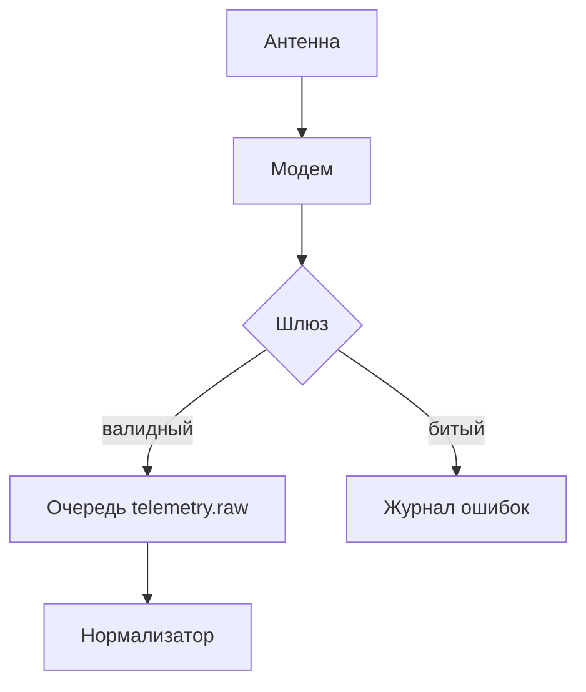

# Документация сервиса «Орбита»

Этот документ — эталонный набор примеров разметки. Каждый блок пронумерован
маркером вида `### [N] …`, чтобы при визуальной проверке было понятно, какой
именно случай отрендерился неверно.

[TOC]

### [1] Заголовки ATX всех уровней

# Уровень 1 — Обзор платформы
## Уровень 2 — Архитектура
### Уровень 3 — Модуль телеметрии
#### Уровень 4 — Очередь событий
##### Уровень 5 — Формат пакета
###### Уровень 6 — Служебные поля

### [2] Закрытый ATX-заголовок

## Конфигурация спутникового канала ##

#### Лимиты и квоты ####

### [3] Setext-заголовки

Подключение к шине «Орбита»
===========================

Обратная совместимость API
--------------------------

### [4] Заголовок с кастомным якорем

## Политика повторных попыток {#retry-policy}

Ссылка на него: [перейти к политике повторов](#retry-policy).

### [5] Заголовок через HTML

<h3>Раздел, размеченный тегом h3</h3>

### [6] Абзацы

Первый абзац описывает назначение шлюза. Шлюз принимает пакеты телеметрии,
нормализует их и раскладывает по тематическим топикам.

Второй абзац отделён пустой строкой. Он рассказывает про буферизацию: если
приёмник недоступен, пакеты копятся в локальном журнале до четырёх часов.

### [7] Жёсткие переносы строк

Вариант с двумя пробелами в конце строки:  
первая строка заканчивается двумя пробелами,  
вторая тоже,  
третья завершает блок.

Вариант с обратным слэшем:\
строка после слэша,\
и ещё одна.

Вариант с тегом: первая строка<br>вторая строка<br/>третья строка.

### [8] Ленивое продолжение абзаца

Этот абзац начинается здесь
и продолжается на следующей строке без отступа,
а затем ещё на одной — всё это должно склеиться в один абзац.

### [9] Неразрывный пробел

Значение таймаута:&nbsp;30&nbsp;секунд, размер пакета:&nbsp;1&nbsp;КБ.

### [10] Курсив

Со звёздочками: *мягкое ограничение скорости*.

С подчёркиваниями: _жёсткое ограничение скорости_.

### [11] Жирный

С двойными звёздочками: **обязательный параметр**.

С двойными подчёркиваниями: __критическая ошибка__.

### [12] Жирный курсив

Тройные звёздочки: ***немедленная остановка обработки***.

Тройные подчёркивания: ___немедленная остановка обработки___.

Комбинация: **_немедленная остановка обработки_**.

Обратная комбинация: _**немедленная остановка обработки**_.

Вложенная: *курсив с **жирным** внутри*.

### [13] Зачёркнутый текст

Двойная тильда: ~~метод deprecated с версии 3.1~~.

Одинарная тильда: ~в некоторых парсерах тоже зачёркивание~.

### [14] Подчёркивание и выделение маркером

Тег u: <u>подчёркнутый фрагмент</u>.

Двойное равно: ==выделенный маркером фрагмент==.

Тег mark: <mark>выделенный маркером фрагмент</mark>.

### [15] Верхний и нижний индексы

Площадь панели: 12 м^2^ и 12 м<sup>2</sup>.

Формула воды: H~2~O и H<sub>2</sub>O.

### [16] Клавиши

Прервать передачу: <kbd>Ctrl</kbd> + <kbd>C</kbd>.
Открыть консоль: <kbd>Cmd</kbd> + <kbd>Shift</kbd> + <kbd>J</kbd>.

### [17] Внутрисловное выделение

Идентификатор orbita*gateway*v2 содержит выделение внутри слова.

А вот snake_case_имя не должно распадаться на курсив.

### [18] Простая цитата

> Шлюз гарантирует доставку хотя бы один раз, но не гарантирует порядок.
> Порядок восстанавливается получателем по полю sequence.

### [19] Вложенные цитаты

> Первый уровень: сообщение оператора наземной станции.
>
> > Второй уровень: ответ дежурного инженера.
> >
> > > Третий уровень: резолюция руководителя смены.

### [20] Ленивая цитата

> Маркер цитаты стоит только на первой строке,
остальные строки идут без него
и всё равно должны попасть в цитату.

### [21] Цитата с вложенными блоками

> #### Заголовок внутри цитаты
>
> Список внутри цитаты:
>
> - первый пункт
> - второй пункт
>
> Код внутри цитаты:
>
> ```bash
> orbita-cli status --verbose
> ```
>
> | Параметр | Значение |
> | --- | --- |
> | retries | 5 |

### [22] Алерты GitHub

> [!NOTE]
> Обновление конфигурации применяется без перезапуска шлюза.

> [!TIP]
> Используйте флаг `--dry-run`, чтобы проверить изменения заранее.

> [!IMPORTANT]
> Ключ доступа выдаётся один раз и не восстанавливается.

> [!WARNING]
> Снижение таймаута ниже 5 секунд приводит к ложным разрывам.

> [!CAUTION]
> Команда `orbita-cli purge` безвозвратно удаляет журнал событий.

### [23] Маркированные списки: три маркера

Через дефис:

- приём пакетов
- нормализация
- маршрутизация

Через звёздочку:

* приём пакетов
* нормализация
* маршрутизация

Через плюс:

+ приём пакетов
+ нормализация
+ маршрутизация

### [24] Нумерованные списки: точка и скобка

1. Подключить антенну
2. Запустить калибровку
3. Дождаться синхронизации

1) Подключить антенну
2) Запустить калибровку
3) Дождаться синхронизации

### [25] Нумерация с произвольного старта

5. Пятый шаг процедуры
6. Шестой шаг процедуры
7. Седьмой шаг процедуры

### [26] Все пункты с номером 1

1. Первый пункт, записанный как «1.»
1. Второй пункт, записанный как «1.»
1. Третий пункт, записанный как «1.»

### [27] Вложенные списки

- Наземный сегмент
  - Основная станция
    - Антенный пост
    - Пультовая
  - Резервная станция
- Космический сегмент
  - Полезная нагрузка
  - Служебная платформа

### [28] Tight и loose списки

Плотный список (без пустых строк):

- строка A
- строка B
- строка C

Разреженный список (с пустыми строками — пункты оборачиваются в абзацы):

- строка A

- строка B

- строка C

### [29] Многоабзацный пункт списка

1. Первый шаг процедуры калибровки.

   Второй абзац того же пункта: убедитесь, что температура приёмника
   стабилизировалась в пределах ±0,5 °C.

   Третий абзац того же пункта: зафиксируйте показания в журнале.

2. Второй шаг процедуры.

### [30] Блоки внутри пункта списка

- Пункт с блоком кода:

  ```json
  { "mode": "calibration", "timeout": 30 }
  ```

- Пункт с цитатой:

  > Калибровка занимает до 12 минут.

- Пункт с таблицей:

  | Этап | Длительность |
  | --- | --- |
  | Прогрев | 4 мин |
  | Замер | 8 мин |

### [31] Смешанная вложенность

1. Нумерованный верхний уровень
   - маркированный вложенный
   - ещё один вложенный
     1. снова нумерованный
     2. и ещё один
2. Второй нумерованный пункт
   + вложенный через плюс
     * вложенный через звёздочку

### [32] Чек-листы

- [ ] Проверить питание антенны
- [x] Обновить прошивку модема
- [X] Синхронизировать время по NTP
- [ ] Согласовать окно обслуживания
  - [x] Уведомить оператора
  - [ ] Получить подтверждение

### [33] Списки определений

Апогей
: Наиболее удалённая от Земли точка орбиты.

Перигей
: Наиболее близкая к Земле точка орбиты.

Наклонение
: Угол между плоскостью орбиты и плоскостью экватора.
: Измеряется в градусах, от 0 до 180.

### [34] Инлайн-код

Запустите `orbita-cli sync --force`, затем проверьте переменную `ORBITA_TOKEN`.

### [35] Инлайн-код с бэктиком и пробелами внутри

Обратный апостроф внутри кода: `` эта строка содержит ` символ ``.

Двойной бэктик с обрезкой пробелов: `` `выделенное` ``.

Код с решёткой: `` #region `` и `` ``вложенные`` ``.

### [36] Блок кода с отступом в 4 пробела

    function normalize(packet) {
      return {
        id: packet.id,
        ts: Date.now(),
      };
    }

### [37] Блок кода с отступом табом

	SELECT id, ts, payload
	FROM telemetry
	WHERE station = 'orbita-1'
	ORDER BY ts DESC;

### [38] Fenced-блок на бэктиках

```
Простой блок без указания языка.
Отступы   и   пробелы   сохраняются.
```

### [39] Fenced-блок на тильдах

~~~
Блок, ограниченный тильдами.
Внутри можно свободно писать ``` без экранирования.
~~~

### [40] Fence из четырёх бэктиков с вложенным блоком

````markdown
Пример документа, внутри которого есть свой блок кода:

```python
def orbit_period(a, mu=398600.4418):
    return 2 * 3.141592653589793 * (a ** 3 / mu) ** 0.5
```

Конец примера.
````

### [41] Info string: разные языки

```js
export function buildPacket(payload) {
  const header = { v: 2, ts: Date.now() };
  return JSON.stringify({ ...header, payload });
}
```

```python
class Station:
    def __init__(self, name, lat, lon):
        self.name = name
        self.lat = lat
        self.lon = lon

    def visible(self, sat):
        return sat.elevation_from(self.lat, self.lon) > 5.0
```

```bash
#!/usr/bin/env bash
set -euo pipefail
orbita-cli auth login --token "$ORBITA_TOKEN"
orbita-cli stream --topic telemetry.raw | jq '.payload'
```

```sql
SELECT station, count(*) AS packets
FROM telemetry
WHERE ts > now() - interval '1 hour'
GROUP BY station
HAVING count(*) > 1000;
```

```yaml
gateway:
  host: 0.0.0.0
  port: 8443
  retries: 5
  topics:
    - telemetry.raw
    - telemetry.normalized
```

```html
<div class="orbita-widget">
  <span data-role="status">online</span>
</div>
```

```css
.orbita-widget {
  display: grid;
  gap: 8px;
  color: #1a1a1a;
}
```

### [42] Info string с атрибутами

```js {2,4-6}
const config = loadConfig();
const client = new OrbitaClient(config);
await client.connect();
client.on('packet', (p) => {
  store.push(normalize(p));
});
client.on('error', console.error);
```

```ts title="src/gateway/client.ts" showLineNumbers
export interface Packet {
  id: string;
  ts: number;
  payload: Uint8Array;
}
```

### [43] Diff-блок

```diff
 function normalize(packet) {
-  return { id: packet.id };
+  return {
+    id: packet.id,
+    ts: packet.ts ?? Date.now(),
+  };
 }
```

### [44] Диаграмма mermaid



### [45] Блоки plaintext и text

```plaintext
2026-09-21T10:14:02Z INFO  gateway started, pid=4412
2026-09-21T10:14:03Z WARN  clock drift 180ms
2026-09-21T10:14:09Z ERROR packet crc mismatch, id=8f21ac
```

```text
Обычный текстовый блок без подсветки.
```

### [46] Инлайн-ссылка

Смотрите [справочник по API](https://example.com/orbita/api) перед интеграцией.

### [47] Ссылка с заголовком: три варианта кавычек

Двойные кавычки: [панель управления](https://example.com/dashboard "Панель «Орбита»").

Одинарные кавычки: [журнал событий](https://example.com/logs 'Журнал событий').

Круглые скобки: [статус сервиса](https://example.com/status (Текущий статус)).

### [48] URL в угловых скобках

Ссылка с пробелами в адресе: [архив отчётов](<https://example.com/orbita/отчёты за 2026/>).

### [49] Относительные и якорные ссылки

Относительная: [руководство по установке](./docs/install.md).

На уровень выше: [общий readme](../README.md).

Якорная: [к политике повторов](#retry-policy).

Относительная с якорем: [раздел про лимиты](./docs/limits.md#quota).

### [50] Автоссылки в угловых скобках

Документация: <https://example.com/orbita/docs>

Небезопасный протокол: <http://legacy.example.com/orbita>

FTP-зеркало: <ftp://mirror.example.com/orbita/>

### [51] Почтовая автоссылка

Поддержка: <support@example.com>

### [52] Голая ссылка GFM

Без всякой разметки: https://example.com/orbita/status — должна стать кликабельной.

С www: www.example.com/orbita тоже обычно распознаётся.

### [53] Ссылочная ссылка (полная форма)

Начните с [руководства оператора][operator-guide], затем изучите
[протокол обмена][protocol-spec].

### [54] Свёрнутая ссылочная форма

Краткий вариант записи: [operator-guide][].

### [55] Сокращённая ссылочная форма

Совсем краткий вариант: [protocol-spec].

### [56] Ссылка-картинка

[](https://example.com/orbita/scheme)

### [57] Ссылка mailto

Напишите на [адрес дежурной смены](mailto:duty@example.com?subject=Инцидент).

### [58] Wiki-ссылки

Перейти к странице [[Протокол обмена]].

С альтернативным текстом: [[Протокол обмена|подробное описание протокола]].

### [59] Референсы GitHub

Автор изменения: @gypsygoose. Связанная задача: #2760.
Кросс-репозиторный референс: tildateam/orbita#118.
Коммит: bd2f84a0.

### [60] Изображение: базовая форма


### [61] Изображение с заголовком


### [62] Ссылочные изображения

Полная форма: ![Логотип «Орбита»][logo]

Свёрнутая форма: ![logo][]

Сокращённая форма: ![logo]

### [63] Изображение через HTML с размерами


<p align="center">
  
</p>

### [64] Изображение с размерами через расширение синтаксиса


### [65] Изображение с пустым alt


### [66] Базовая таблица

| Станция | Широта | Долгота | Статус |
| --- | --- | --- | --- |
| Орбита-1 | 55.75 | 37.62 | online |
| Орбита-2 | 59.94 | 30.31 | offline |
| Орбита-3 | 43.12 | 131.89 | online |

### [67] Выравнивание колонок

| По левому краю | По центру | По правому краю | По умолчанию |
| :--- | :---: | ---: | --- |
| приём | 1024 | 12.5 | норма |
| передача | 2048 | 148.75 | норма |
| резерв | 512 | 3.0 | ожидание |

### [68] Таблица без внешних пайпов

Параметр | Значение | Единица
--- | --- | ---
timeout | 30 | сек
retries | 5 | шт
buffer | 64 | КБ

### [69] Экранированный вертикальный пайп в ячейке

| Выражение | Описание |
| --- | --- |
| `a \| b` | побитовое ИЛИ |
| `a &#124;&#124; b` | логическое ИЛИ через сущность |
| a \| b | побитовое ИЛИ |
| a &#124;&#124; b | логическое ИЛИ через сущность |
| `grep x \| wc -l` | конвейер |

### [70] Форматирование внутри ячеек

| Элемент | Пример | Ссылка |
| --- | --- | --- |
| **жирный** | *курсив* | [док](https://example.com) |
| `inline code` | ~~зачёркнутый~~ | <kbd>Esc</kbd> |
| Список через `<br>` | один<br>два<br>три |  |

### [71] Неровное число ячеек и пустые ячейки

| A | B | C |
| --- | --- | --- |
| 1 | 2 | 3 | 4 | 5 |
| 1 | 2 |
|  | 2 |  |
| 1 |  | 3 |

### [72] HTML-таблица

<table>
  <thead>
    <tr><th>Канал</th><th>Частота</th><th>Модуляция</th></tr>
  </thead>
  <tbody>
    <tr><td>Прямой</td><td>2200 МГц</td><td>QPSK</td></tr>
    <tr><td>Обратный</td><td>2025 МГц</td><td>BPSK</td></tr>
  </tbody>
</table>

### [73] Горизонтальные линии во всех вариантах

Три дефиса:

---

Три звёздочки:

***

Три подчёркивания:

___

Больше трёх символов:

----------

**********

С пробелами между символами:

- - -

* * *

_ _ _

### [74] Раскрывающийся блок details

<details>
<summary>Полный перечень кодов ошибок</summary>

| Код | Значение |
| --- | --- |
| E001 | Нет несущей |
| E002 | Ошибка CRC |
| E003 | Переполнение буфера |

Коды с префиксом `E1xx` относятся к наземному сегменту.

</details>

<details open>
<summary>Изначально раскрытый блок</summary>

Этот блок отрендерен в открытом состоянии.

</details>

### [75] Выравнивание через HTML

<div align="center">
Этот текст выровнен по центру средствами HTML.
</div>

<div align="right">
А этот — по правому краю.
</div>

### [76] Инлайн-HTML

Аббревиатура: <abbr title="Telemetry, Tracking and Command">TT&amp;C</abbr>.

Мелкий шрифт: <small>значения приведены для температуры 20 °C</small>.

Произвольный span: <span style="color: #c0392b">красный фрагмент</span>.

Код через тег: <code>orbita-cli --help</code>.

Курсив и жирный тегами: <em>акцент</em> и <strong>важно</strong>.

### [77] HTML-комментарий

<!-- Этот комментарий не должен отображаться в отрендеренном виде -->
Текст после комментария.
<!--
Многострочный комментарий.
Вторая строка комментария.
-->

### [78] Комментарии через ссылочный хак

[//]: # (Скрытая заметка: проверить актуальность таблицы частот)

[comment]: <> (Ещё один вариант скрытого комментария)

Текст после скрытых заметок.

### [79] Markdown внутри HTML-блока

<div markdown="1">

Внутри этого div должен работать **markdown**: курсив, `код` и список.

- первый пункт
- второй пункт

</div>

<div>

А здесь атрибута нет — поведение зависит от парсера: *это* может остаться сырым текстом.

</div>

### [80] Экранирование обратным слэшем

Звёздочки: \*не курсив\*, подчёркивания: \_не курсив\_.

Решётка: \# не заголовок.

Квадратные скобки: \[не ссылка\]\(не адрес\).

Бэктик: \` не код \`.

Обратный слэш: \\ одиночный символ.

Тильда: \~\~не зачёркнуто\~\~.

Пайп: a \| b вне таблицы.

Плюс и дефис в начале строки:

\+ не список, 

\- тоже не список.

Цифра с точкой:

2026\. это не нумерованный список.

### [81] Именованные HTML-сущности

Копирайт &copy;, торговая марка &trade;, зарегистрированный знак &reg;.

Амперсанд &amp;, меньше &lt;, больше &gt;, кавычка &quot;.

Многоточие &hellip;, длинное тире &mdash;, короткое тире &ndash;.

Стрелки &larr; &rarr; &harr;, градус 25&deg;C, плюс-минус &plusmn;0,5.

### [82] Числовые сущности

Десятичные: &#169; &#174; &#8364; &#1054;&#1088;&#1073;&#1080;&#1090;&#1072;.

Шестнадцатеричные: &#x00A9; &#x2764; &#x1F680; &#x2192;.

### [83] Сноски

Скорость передачи ограничена шириной канала[^1], а задержка зависит от высоты
орбиты[^orbit-height]. Для низких орбит применяется отдельный расчёт[^low-orbit].

### [84] Многоабзацная сноска

Процедура аварийного отключения описана в регламенте[^emergency].

### [85] Инлайн-сноска

Резервный канал активируется автоматически^[задержка активации — до 40 секунд].

### [86] Инлайн-математика

Долларовая нотация: период обращения равен $T = 2\pi\sqrt{a^3/\mu}$ при $\mu = 398600$ км³/с².

Скобочная нотация: скорость на круговой орбите \(v = \sqrt{\mu/r}\).

### [87] Блочная математика

$$
\Delta v = v_e \ln\frac{m_0}{m_f}
$$

\[
E = -\frac{\mu}{2a}
\]

### [88] Блок кода с языком math

```math
r(\theta) = \frac{a(1 - e^2)}{1 + e\cos\theta}
```

### [89] Маркеры оглавления

[[_TOC_]]

{:toc}

### [90] Аббревиатуры

*[TLE]: Two-Line Element set
*[GEO]: Geostationary Earth Orbit
*[LEO]: Low Earth Orbit

Аппарат выведен на LEO, целевая точка — GEO. Параметры берутся из TLE.

### [91] Атрибуты блока

Абзац с классом и идентификатором.
{: .warning #note-quota }

## Заголовок с атрибутами {: .collapsible }

### [92] Admonitions в стиле «:::»

:::note
Обычная информационная врезка.
:::

:::tip Полезный совет
Кешируйте TLE на стороне клиента — сервер обновляет их раз в 8 часов.
:::

:::info[Заголовок в скобках]
Вариант синтаксиса с заголовком в квадратных скобках.
:::

:::warning
Не запускайте калибровку во время сеанса связи.
:::

:::danger
Сброс конфигурации приводит к потере привязки антенны.
:::

### [93] Admonitions в стиле MkDocs

!!! note "Заметка"
    Отступ в четыре пробела является частью синтаксиса.

!!! warning
    Врезка без собственного заголовка.

??? tip "Свёрнутая врезка"
    Содержимое раскрывается по клику.

### [94] Эмодзи

Шорткоды: :rocket: :satellite: :white_check_mark: :warning: :+1: :fire:

Юникод напрямую: 🚀 🛰️ ✅ ⚠️ 👍 🔥

Эмодзи в заголовке и списке:

- 🚀 канал в норме
- :yellow_circle: повышенная задержка
- 🔥 канал потерян

### [95] Типографика (smartypants)

Тире: длинное --- вот так, среднее -- вот так.

Многоточие: ждём подтверждения...

Кавычки: "двойные кавычки" и 'одинарные кавычки'.

Дроби и знаки: 1/2, (c), (r), (tm).

---

<!-- Определения ссылок и сносок -->

[operator-guide]: https://example.com/orbita/operator "Руководство оператора"
[protocol-spec]: https://example.com/orbita/protocol
  "Спецификация протокола обмена, перенесённая на следующую строку"
[logo]: https://placehold.co/100x40/png "Логотип «Орбита»"

[^1]: Ширина канала измеряется в мегагерцах и задаётся оператором связи.
[^orbit-height]: Для орбиты 550 км задержка в одну сторону составляет около 2 мс.
[^low-orbit]: Низкой считается орбита ниже 2000 км.
[^emergency]: Первый абзац сноски: обесточить усилитель мощности.

    Второй абзац той же сноски: зафиксировать время отключения в журнале
    и уведомить дежурную смену по резервному каналу.

    Третий абзац: дождаться письменного подтверждения от руководителя смены.

---

## Крайние случаи

### [96] Пустые конструкции

Пустой блок кода:

```
```

Таблица без строк данных:

| Колонка A | Колонка B |
| --- | --- |

Список с пустым пунктом:

-
- непустой пункт
-

Заголовок без текста:

###

Ссылка с пустым текстом: [](https://example.com).

Ссылка с пустым адресом: [текст без адреса]().

### [97] Очень длинная строка без пробелов

orbitaGatewayTelemetryNormalizationPipelineSegmentorbitaGatewayTelemetryNormalizationPipelineSegmentorbitaGatewayTelemetryNormalizationPipelineSegmentorbitaGatewayTelemetryNormalizationPipelineSegmentorbitaGatewayTelemetryNormalizationPipelineSegmentorbitaGatewayTelemetryNormalizationPipelineSegment

В инлайн-коде: `orbitaGatewayTelemetryNormalizationPipelineSegmentorbitaGatewayTelemetryNormalizationPipelineSegmentorbitaGatewayTelemetryNormalizationPipelineSegmentorbitaGatewayTelemetryNormalizationPipelineSegmentorbitaGatewayTelemetryNormalizationPipelineSegmentorbitaGatewayTelemetryNormalizationPipelineSegment`

В ссылке: [orbitaGatewayTelemetryNormalizationPipelineSegmentorbitaGatewayTelemetryNormalizationPipelineSegmentorbitaGatewayTelemetryNormalizationPipelineSegmentorbitaGatewayTelemetryNormalizationPipelineSegmentorbitaGatewayTelemetryNormalizationPipelineSegmentorbitaGatewayTelemetryNormalizationPipelineSegment](https://example.com/orbitaGatewayTelemetryNormalizationPipelineSegmentorbitaGatewayTelemetryNormalizationPipelineSegmentorbitaGatewayTelemetryNormalizationPipelineSegmentorbitaGatewayTelemetryNormalizationPipelineSegmentorbitaGatewayTelemetryNormalizationPipelineSegmentorbitaGatewayTelemetryNormalizationPipelineSegment)

В блоке кода:

```
orbitaGatewayTelemetryNormalizationPipelineSegmentorbitaGatewayTelemetryNormalizationPipelineSegmentorbitaGatewayTelemetryNormalizationPipelineSegmentorbitaGatewayTelemetryNormalizationPipelineSegmentorbitaGatewayTelemetryNormalizationPipelineSegmentorbitaGatewayTelemetryNormalizationPipelineSegment
```

### [98] Очень широкая таблица

| Колонка 1 | Колонка 2 | Колонка 3 | Колонка 4 | Колонка 5 | Колонка 6 | Колонка 7 | Колонка 8 | Колонка 9 | Колонка 10 | Колонка 11 | Колонка 12 | Колонка 13 | Колонка 14 |
| --- | --- | --- | --- | --- | --- | --- | --- | --- | --- | --- | --- | --- | --- |
| знач-1.1 | знач-1.2 | знач-1.3 | знач-1.4 | знач-1.5 | знач-1.6 | знач-1.7 | знач-1.8 | знач-1.9 | знач-1.10 | знач-1.11 | знач-1.12 | знач-1.13 | знач-1.14 |
| знач-2.1 | знач-2.2 | знач-2.3 | знач-2.4 | знач-2.5 | знач-2.6 | знач-2.7 | знач-2.8 | знач-2.9 | знач-2.10 | знач-2.11 | знач-2.12 | знач-2.13 | знач-2.14 |
| знач-3.1 | знач-3.2 | знач-3.3 | знач-3.4 | знач-3.5 | знач-3.6 | знач-3.7 | знач-3.8 | знач-3.9 | знач-3.10 | знач-3.11 | знач-3.12 | знач-3.13 | знач-3.14 |

### [99] Смешение письменностей и направлений

Кириллица, latin text, 中文字符, 日本語のテキスト, 한국어 텍스트.

Арабский текст справа налево: مرحبا بالعالم — и снова слева направо.

Иврит: שלום עולם — и продолжение обычным текстом.

Смешанный абзац: параметр `timeout` (تأخير) равен 30 с, см. 参数表 ниже.

Эмодзи с модификаторами: 👨‍🚀 👩🏽‍🔬 🏳️‍🌈 и комбинирующие символы: é vs é.

### [100] Символы разметки внутри кода

Инлайн: `**не жирный** _не курсив_ # не заголовок | не таблица`.

Блок:

```
# Это не заголовок
- Это не список
| Это | не | таблица |
> Это не цитата
**Это не жирный текст**
[Это](не ссылка)

```

Инлайн-код с HTML: `<div class="test">содержимое</div>` и `<script>alert(1)</script>`.

Блок с HTML внутри:

```html
<script>
  document.write("<b>жирный</b>");
</script>
```

### [101] Незакрытые и некорректные конструкции

Незакрытое жирное выделение: **этот текст открыт, но не закрыт

Незакрытый инлайн-код: `здесь открыт бэктик, но не закрыт

Незакрытая ссылка: [текст без закрывающей скобки](https://example.com

Одиночный символ разметки: * не список, потому что нет содержимого.

Незакрытый HTML-тег: <span class="broken">этот span не закрыт

Текст после незакрытого тега должен всё равно отрендериться.

### [102] Глубокая вложенность всех блоков

> Уровень 1 — цитата.
>
> 1. Нумерованный пункт внутри цитаты.
>
>    - Вложенный маркированный пункт.
>
>      > Цитата внутри вложенного пункта.
>      >
>      > ```js
>      > // блок кода внутри цитаты внутри пункта внутри цитаты
>      > const depth = 4;
>      > ```
>      >
>      > | Глубина | Элемент |
>      > | :--- | ---: |
>      > | 1 | цитата |
>      > | 2 | список |
>      > | 3 | цитата |
>      > | 4 | код и таблица |
>
>    - Второй вложенный пункт с **жирным**, *курсивом* и `кодом`.
>
> 2. Второй нумерованный пункт.
>
> Завершающий абзац цитаты.

Конец документа.
